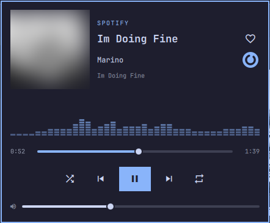

<div align="center">


# Omarchy Player

**A now-playing panel that lives in your Omarchy bar and wears your theme.**

Spotify, browsers, mpv and anything else that speaks MPRIS, with a live audio spectrum.

[](LICENSE)
[](https://omarchy.org)
[](https://quickshell.org)
[](https://github.com/CodeSieb/omarchy-player/stargazers)



</div>

## Features

- 🎨 **Follows your theme:** colours come from the active Omarchy theme
- 📊 **Real spectrum:** reads PipeWire audio, and only while the panel is open
- 🎛️ **Full controls:** seek, volume, shuffle, repeat and source switching
- ❤️ **Spotify likes:** a heart that shows your real Liked Songs (optional login)
- 🎧 **Spotify DJ:** start DJ, or press its genre switch, from the panel (optional setup)
- ⌨️ **Keyboard first:** drive everything without the mouse
- 🫥 **Stays out of the way:** hides when no player is open

## Install

Requires Omarchy 4 and `python-numpy`.

```bash
omarchy plugin add https://github.com/CodeSieb/omarchy-player.git --enable
```

Or clone the repo and run `./install.sh`.

## Usage

| In the bar | Action |
|---|---|
| Click | Open the panel |
| Middle-click | Play or pause |
| Right-click | Next track |
| Scroll | Player volume |

| In the panel | Action |
|---|---|
| `Space` | Play or pause |
| `n` / `p` | Next or previous |
| `h` / `l` | Seek 5 seconds |
| `j` / `k` | Volume |
| `s` / `r` | Shuffle or repeat |
| `c` | Next source |
| `f` | Like in Spotify |
| `d` | Spotify DJ |
| `Esc` | Close |

To open the panel with a shortcut, bind `omarchy-shell codesieb.omarchy-player toggle`.

Settings: `maxTitleLength`, `visualizer` and `hideWhenIdle`.

## Spotify setup (optional)

Everything above except the live heart and DJ switch works without this.

### Liked Songs

1. Create an app in the [Spotify developer dashboard](https://developer.spotify.com/dashboard).
   Tick **Web API** and use this redirect URI: `http://127.0.0.1:43117/callback`
2. Save its client ID and log in:

```bash
mkdir -p ~/.config/omarchy-player ~/.local/state/omarchy-player
echo YOUR_CLIENT_ID > ~/.config/omarchy-player/client_id
python3 ~/.config/omarchy/plugins/codesieb.omarchy-player/spotify.py login
```

Your token stays in `~/.local/state/omarchy-player/spotify.json`. Delete that file to log out.

### DJ switch

Spotify has no API for this button, so the player presses it through Spotify's local debug port:

```bash
echo '--remote-debugging-port=9229' >> ~/.config/spotify-flags.conf
```

Restart Spotify afterwards. `spotify-flags.conf` is read by the Arch package.

> [!WARNING]
> While Spotify runs, any program on your computer can control it through this port.
> Automating the app may also conflict with Spotify's terms, so enable it at your own discretion.
> Spotify updates can move the button, in which case the logo falls back to a normal skip.

## How it works

| File | Job |
|---|---|
| `Panel.qml` | Bar widget and panel, using Quickshell's MPRIS service |
| `visualizer.py` | Captures the default output with `pw-record` and runs the FFT |
| `spotify.py` | Spotify login, Liked Songs and the DJ switch |

## License

[MIT](LICENSE). Not affiliated with Spotify or Omarchy.
